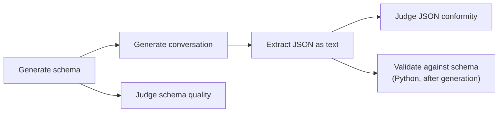

import { Authors } from "@/components/Authors";

<Authors ids={["nmulepati"]} />

Your preview looks good. The schemas are varied, the conversations make sense, and the generated JSON passes validation. You are ready to go from a few records to a few hundred million.

Then the practical questions show up. How many requests should be in flight? Is the model actually keeping the GPUs busy? Will the run finish before the partition's time limit? And if it doesn't, how much work do you have to repeat?

These questions are part of building synthetic data at scale. With `data-designer-slurm`, we can bring them into the same workflow: benchmark the pipeline, choose a deployment, split the generation into manageable allocations, and recover unfinished work from durable state.

{/* more */}


## The Pipeline We're Scaling

We'll use the smaller JSON demo from [Structured Outputs for Nemotron](/dev-notes/structured-outputs-from-nemotron):



Each record has its own generated schema, used for extraction, both model judges, and the Python validation check.

## Prepare the Pipeline for Slurm

Install the optional extension in a shared Python environment:

```bash
python -m pip install "data-designer[slurm]"
```

Follow [Slurm Getting Started](/slurm/getting-started) to configure a cluster profile and register a serving image. The submit host and compute nodes need access to the same Python environment and shared workspace.

Before choosing job size and parallelism, check your cluster's scheduling policies:

- **Wall-time limits:** a partition may cap how long each allocation can run. Split larger targets into jobs that fit within that budget, with headroom.
- **Fair-share priority:** where configured, account shares and past usage can affect when jobs start. See Slurm's [fair-share documentation](https://slurm.schedmd.com/priority_multifactor.html).
- **Job and GPU limits:** separate account or QOS limits may cap concurrent jobs and GPUs. See Slurm's [resource-limit documentation](https://slurm.schedmd.com/resource_limits.html).

These settings vary by cluster. The four-hour job budget used below is illustrative, and requested parallelism is an upper bound on simultaneous jobs. **Benchmark and projected execution times exclude queue wait.**

For this example, replace the demo's seed dataset with a category sampler for `topic_category` and a dependent subcategory sampler for `topic_subtopic`, using the same topic map. Keep its other samplers unchanged, then export the recipe to `builder.yaml`.

Keep prompts, sampler distributions, inference settings, and quality checks consistent across benchmark cases. The larger-scale examples later in this post are projections based on these benchmark runs.

Following the demo, the three generation columns and two judge columns share the `nvidia-text` model alias. In this benchmark, all five use the same locally served Nemotron model.

## Benchmark the Pipeline You Intend to Run

Every pipeline places different demands on the model servers and client. Prompts, response lengths, and column dependencies all affect generation throughput. Benchmark the exact pipeline and model settings you intend to run, with representative inputs. Use those measurements to choose concurrency and deployment settings within the GPU limits discussed above, then size each job to fit its wall-time budget.

For the measurements in this post, each node had **eight NVIDIA H100 GPUs with 80 GB of memory per GPU**.

The built-in Slurm benchmark runs the pipeline across combinations of concurrency and deployment settings. Start with a managed run configuration, then describe the sweep.

Create `run-tp8.yaml` beside the exported `builder.yaml`:

```yaml
schema_version: 1
name: structured-outputs-base-tp8
builder:
  source: builder.yaml
invocation:
  num_records: 8192
  dataset_name: structured-outputs
  resume: if_possible
  model_concurrency:
    nvidia-text: 128
  run_config:
    max_in_flight_tasks: 8192
client:
  cpus: 16
deployments:
  - model_alias: nvidia-text
    model: nvidia/NVIDIA-Nemotron-3.5-Super-VL-120B-A12B-BF16
    served_model_name: nvidia/NVIDIA-Nemotron-3.5-Super-VL-120B-A12B-BF16
    server:
      type: vllm
      image:
        name: vllm
      startup_timeout: 20m
      queue_backpressure:
        max_waiting_requests: 8192
        retry_after_seconds: 1
      extra_args: [
        --max-model-len, "16384", --max-num-seqs, "8192",
        --gpu-memory-utilization, "0.90", --enforce-eager,
        --trust-remote-code, --reasoning-parser, nemotron_v3,
        --limit-mm-per-prompt, '{"image":0,"video":0}'
      ]
    resources:
      nodes: 1
    topology:
      tensor_parallel: 8
      nodes_per_replica: 1
submission:
  time_limit: 04:00:00
```

Here, `image.name: vllm` selects the serving container image registered during cluster setup. If you registered it under a different name, use that name instead.

The cluster profile requests eight GPUs per node. This base run uses TP8 with the default PP1, giving one replica per node. Save a copy as `run-tp4.yaml`, change its name to `structured-outputs-base-tp4`, and set `tensor_parallel: 4` for two replicas per node. Keep all other settings identical.

`--max-num-seqs` limits active sequences **per replica**. Keep it fixed across the sweep and large enough to cover the largest client concurrency you plan to test. Here, 8,192 covers the sweep below and possible extensions, even if requests are unevenly distributed across replicas. This removes that setting as a lower concurrency ceiling; available KV cache and token budgets can still limit execution.

A low `max_waiting_requests` can make a busy replica reject requests and the client slow down. At two nodes with TP8 and concurrency 2,048, we measured 10.05 records/s with a queue limit of 128 and 14.76 with a limit of 8,192. Every case below uses 8,192.

Create `benchmark-one-node-tp8.yaml` for the TP8 sweep:

```yaml
schema_version: 1
name: structured-outputs-one-node-tp8
base_run: run-tp8.yaml
model_aliases: [nvidia-text]
concurrency_values: [128, 256, 512, 1024, 2048, 4096]
record_policy:
  type: fixed
  records: 8192
deployment_cases:
  - name: one-node
    deployments:
      nvidia-text:
        nodes: 1
        nodes_per_replica: 1
analysis:
  target_total_records: 1000000
  target_runtime: 4h
```

Copy it to `benchmark-two-nodes-tp8.yaml`, set `name: structured-outputs-two-nodes-tp8`, change the deployment case name to `two-nodes`, and set `nodes: 2`.

For TP4, copy these two sweep files to `benchmark-one-node-tp4.yaml` and `benchmark-two-nodes-tp4.yaml`. In both copies, set `base_run: run-tp4.yaml` and replace `tp8` with `tp4` in the benchmark name. All four setups use the same six concurrency limits, for 24 cases of 8,192 requested records each.

The `nvidia-text` concurrency limit is shared by all five model columns. Adding replicas does not automatically increase it. TP and PP stay fixed within each sweep.

```bash
data-designer slurm benchmark run benchmark-one-node-tp8.yaml
data-designer slurm benchmark run benchmark-two-nodes-tp8.yaml
data-designer slurm benchmark run benchmark-one-node-tp4.yaml
data-designer slurm benchmark run benchmark-two-nodes-tp4.yaml
```

The commands return benchmark IDs and child run IDs. Inspect children with normal status commands, then analyze each benchmark:

```bash
data-designer slurm status CHILD_RUN_ID
data-designer slurm benchmark analyze BENCHMARK_ID --refresh-state
```

The `Recommendations` section compares cases within one benchmark ID. A case is `pareto` if no other eligible case reduces the projected job count or GPU-hours without increasing the other. Each report below had one eligible case, so each lists that case as `pareto`.

```text
# Two-node TP8 at concurrency 2,048
Recommendations:
  1.
    Kind: pareto
    Case id: 2node-c2048-c2048
  2.
    Kind: minimum_jobs
    Case id: 2node-c2048-c2048

# One-node TP8 at concurrency 2,048
Recommendations:
  1.
    Kind: pareto
    Case id: tp8-1node-c2048-c2048
  3.
    Kind: minimum_gpu_hours
    Case id: tp8-1node-c2048-c2048
```

Among the eligible cases, only two-node TP8 at 2,048 projected five jobs for one million records. One-node TP8 at 2,048 and 4,096 tied for the lowest GPU budget. Each projected six eight-GPU jobs, or 192 GPU-hours if every job uses its full four hours. The analyzer uses `target_runtime` for these projections. Slurm enforces the job’s `time_limit`.

The plots below use measured records/s and GPU-hours per 1,000 generated records. We checked the client start and finish times against logs and benchmark reports, and used Slurm accounting for GPU-hours. Both measures exclude queue wait.

## Tune Each Setup Before Comparing Them

We tested two ways to serve [Nemotron 3.5 Super VL 120B-A12B BF16](https://huggingface.co/nvidia/NVIDIA-Nemotron-3.5-Super-VL-120B-A12B-BF16) on eight H100s per node. TP4 ran two model replicas per node, each using four GPUs. TP8 ran one replica across all eight. Both layouts used vLLM 0.32.0 with pipeline parallelism set to one and expert parallelism off.

To find where throughput leveled off, we tested each layout on one and two nodes, doubling client concurrency from 128 through 4,096. Each allocation used one Data Designer client.


On one node, TP4 stayed between 4.45 and 4.52 records/s as concurrency rose from 512 to 4,096. TP8 kept gaining throughput through 2,048. With one replica spread across eight GPUs, TP8 reduced model memory from **57.6 to 29.4 GiB per GPU**. That left **32.3 GiB for the KV cache**, up from **3.8 GiB with TP4**, giving the server more room for active requests.

Doubling TP8 concurrency once more took one-node throughput from 12.57 records/s at 2,048 to 12.40 at 4,096, a 1.3% drop. The 4,096 run used 0.3% fewer GPU-hours, a difference of just three seconds over 8,192 records. With one run per setting, we wouldn’t count on that saving for production.

The same doubling produced a larger drop on two nodes. Throughput fell 5.5%, from the sweep’s highest rate of 14.76 records/s to 13.94.

**For this pipeline, we recommend TP8 at a client concurrency of 2,048 on either one or two nodes.**

**1 node · TP4 · 2 replicas**

| Concurrency limit | Records/s | GPU-h / 1,000 records |
| --- | ---: | ---: |
| 128 | 2.093 | 1.138 |
| 256 | 3.787 | 0.660 |
| 512 | 4.452 | 0.574 |
| 1,024 | 4.467 | 0.599 |
| 2,048 | 4.512 | 0.565 |
| 4,096 | 4.518 | 0.565 |

**1 node · TP8 · 1 replica**

| Concurrency limit | Records/s | GPU-h / 1,000 records |
| --- | ---: | ---: |
| 128 | 1.789 | 1.311 |
| 256 | 3.285 | 0.744 |
| 512 | 6.230 | 0.448 |
| 1,024 | 10.717 | 0.273 |
| 2,048 | 12.570 | 0.247 |
| **4,096** | **12.404** | **0.246** |

**2 nodes · TP4 · 4 replicas**

| Concurrency limit | Records/s | GPU-h / 1,000 records |
| --- | ---: | ---: |
| 128 | 2.193 | 2.246 |
| 256 | 4.001 | 1.335 |
| 512 | 7.005 | 0.851 |
| 1,024 | 8.188 | 0.885 |
| 2,048 | 8.395 | 0.915 |
| 4,096 | 8.366 | 0.753 |

**2 nodes · TP8 · 2 replicas**

| Concurrency limit | Records/s | GPU-h / 1,000 records |
| --- | ---: | ---: |
| 128 | 2.042 | 2.361 |
| 256 | 3.554 | 1.452 |
| 512 | 5.101 | 1.075 |
| 1,024 | 11.013 | 0.673 |
| **2,048** | **14.762** | **0.501** |
| 4,096 | 13.945 | 0.506 |

GPU-hours include startup and shutdown. Two trials returned 8,191 records each (one-node TP4 at 256 and two-node TP8 at 1,024). The other trials returned all 8,192. Rates and costs use the number generated.

### How Many Jobs Reach the Target?

To estimate how many four-hour jobs we need for **one million generated records**, subtract measured startup and shutdown time from four hours, then multiply the remaining seconds by the measured records/s. Round the number of jobs up. Each array task counts as one job.

| Setup / concurrency | Records per full job | Jobs for 1M | Estimated GPU-h | GPU-h if all jobs use 4h |
| --- | ---: | ---: | ---: | ---: |
| 1 node · TP8 / 2,048 | 177,749 | 6 | 180 | 192 |
| 1 node · TP8 / 4,096 | 175,549 | 6 | 182 | 192 |
| 2 nodes · TP8 / 2,048 | 207,111 | 5 | 309 | 320 |

For **one million records**, one-node TP8 at 2,048 projects to the lowest GPU cost. At this size each job generates about 167,000 records, so the higher generation rate at 2,048 matters more than the shorter startup at 4,096. If those rates hold for **100 million records**, TP8 at 2,048 would take **563 one-node jobs or 483 two-node jobs**.

We divide the million records evenly among the array tasks and include startup and shutdown for each task. The times below assume the measured rates hold and tasks start as soon as a slot opens. They exclude queue wait, retries, and collection.

| Setup / concurrency | Total jobs | Jobs at once | Peak GPUs | Estimated time for 1M |
| --- | ---: | ---: | ---: | ---: |
| 1 node · TP8 / 2,048 | 6 | 4 | 32 | 7 h 31 min |
| 1 node · TP8 / 4,096 | 6 | 4 | 32 | 7 h 36 min |
| 2 nodes · TP8 / 2,048 | 5 | 4 | 64 | 7 h 44 min |
| 2 nodes · TP8 / 2,048 | 5 | 2 | 32 | 11 h 36 min |

**With four job slots**, one-node and two-node TP8 at 2,048 both need two waves. The one-node jobs finish in an estimated 7 h 31 min using up to 32 GPUs. The two-node jobs take 7 h 44 min using up to 64. **With a fixed budget of 32 GPUs**, only two two-node jobs fit at once, bringing their estimated time to 11 h 36 min.

For the lowest projected GPU cost, copy `run-tp8.yaml` to `production-run.yaml`. Set concurrency to 2,048 and split one million records across six array tasks. The first five request 166,666 records each and the last requests 166,670. Each task projects to about 3 h 45 min including startup and shutdown, leaving 15 minutes before the four-hour limit.

```yaml
invocation:
  num_records: 1000000
  dataset_name: structured-outputs
  resume: if_possible
  model_concurrency:
    nvidia-text: 2048
  run_config:
    max_in_flight_tasks: 8192
array_tasks:
  count: 6
  max_concurrent: 4
```

Here, `max_concurrent: 4` lets four tasks use eight GPUs each, for a peak of 32. For your own run, choose the highest parallelism your GPU budget and cluster limits allow. Slurm determines when each task starts.

Preview the production submission, then launch it:

```bash
data-designer slurm execute production-run.yaml --dry-run
data-designer slurm execute production-run.yaml
```

## Recover the Work That Didn't Finish

Some array jobs may stop because of a time limit, node failure, or model-server error. Retry the failed or incomplete shards to finish the run; completed shards stay intact.


Check the run, preview the retry, then submit it:

```bash
data-designer slurm status RUN_ID
data-designer slurm retry RUN_ID --dry-run
data-designer slurm retry RUN_ID
```

Retries start new model servers and reuse saved progress when possible. Unfinished requests may run again. See [Retry and Collection](/slurm/retry-and-collection) for details.

## Collect the Generated Records

Merge the shard outputs:

```bash
data-designer slurm merge RUN_ID --num-partitions 20
```

Check the collected row count against your target. Some shards may produce fewer records than requested. With the configuration above, you should now have roughly **one million rows across 20 partitions**.

## So What Did We Learn?

For this model, TP8 reduced the memory used by model weights and left more room for concurrent requests. We used the measured throughput and GPU cost to plan job size and parallelism for our pipeline.

Here are some takeaways:

- **Tune before scaling.** Compare model setups and concurrency limits using records/s and GPU-hours, and check that the GPUs stay busy.
- **Choose the node count for your objective.** With TP8 at 2,048, two nodes gave the highest throughput per job. One node projected the fewest GPU-hours for one million rows.
- **Use your allocation.** Run as many jobs in parallel as your GPU budget allows, with each job sized to finish within its time limit.
- **Recover unfinished work.** Retry failed shards and reuse saved progress where possible.

## Resources

- [Structured Outputs for Nemotron](/dev-notes/structured-outputs-from-nemotron)
- [Slurm Getting Started](/slurm/getting-started)
- [Slurm Benchmarks](/slurm/benchmarks)
- [Run Configuration](/slurm/run-configuration)
- [Retry and Collection](/slurm/retry-and-collection)
- [Async All the Way Down](/dev-notes/async-all-the-way-down)
