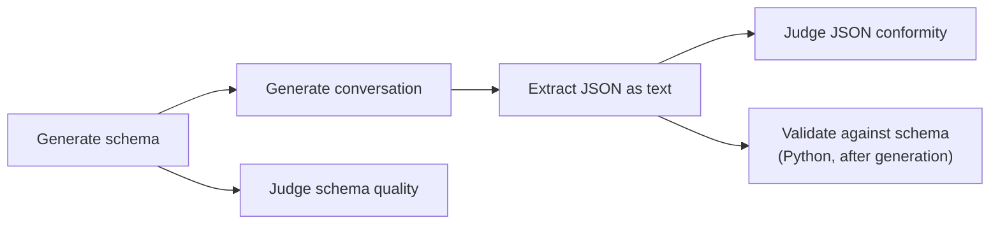

import { Authors } from "@/components/Authors";

<Authors ids={["nmulepati"]} />

Your preview looks good. The schemas are varied, the conversations make sense, and the generated JSON passes validation. You are ready to go from a few records to a few hundred million.

Then the practical questions show up. How many requests should be in flight? Is the model actually keeping the GPUs busy? Will the run finish before the partition's time limit? And if it doesn't, how much work do you have to repeat?

These questions are part of building synthetic data at scale. With `data-designer-slurm`, we can bring them into the same workflow: benchmark the pipeline, choose a deployment, split the generation into manageable allocations, and recover unfinished work from durable state.

{/* more */}


## The Pipeline We're Scaling

We'll use the smaller JSON demo from [Structured Outputs for Nemotron](/dev-notes/structured-outputs-from-nemotron):



Each record has its own generated schema, used for extraction, both model judges, and the Python validation check.

## Prepare the Pipeline for Slurm

Install the optional extension in a shared Python environment:

```bash
python -m pip install "data-designer[slurm]"
```

Follow [Slurm Getting Started](/slurm/getting-started) to configure a cluster profile and register a serving image. The submit host and compute nodes need access to the same Python environment and shared workspace.

Before choosing job size and parallelism, check your cluster's scheduling policies:

- **Wall-time limits:** a partition may cap how long each allocation can run. Split larger targets into jobs that fit within that budget, with headroom.
- **Fair-share priority:** where configured, account shares and past usage can affect when jobs start. See Slurm's [fair-share documentation](https://slurm.schedmd.com/priority_multifactor.html).
- **Job and GPU limits:** separate account or QOS limits may cap concurrent jobs and GPUs. See Slurm's [resource-limit documentation](https://slurm.schedmd.com/resource_limits.html).

These settings vary by cluster. The four-hour job budget used below is illustrative, and requested parallelism is an upper bound on simultaneous jobs. **Benchmark and projected execution times exclude queue wait.**

For this example, replace the demo's seed dataset with a category sampler for `topic_category` and a dependent subcategory sampler for `topic_subtopic`, using the same topic map. Keep its other samplers unchanged, then export the recipe to `builder.yaml`.

Keep prompts, sampler distributions, inference settings, and quality checks consistent across benchmark cases. The larger-scale examples later in this post are projections based on these benchmark runs.

Following the demo, the three generation columns and two judge columns share the `nvidia-text` model alias. In this benchmark, all five use the same locally served Nemotron model.

## Benchmark the Pipeline You Intend to Run

Every pipeline places different demands on the model servers and client. Prompts, response lengths, and column dependencies all affect generation throughput. Benchmark the exact pipeline and model settings you intend to run, with representative inputs. Use those measurements to choose concurrency and deployment settings within the GPU limits discussed above, then size each job to fit its wall-time budget.

For the measurements in this post, each node had **eight NVIDIA H100 GPUs with 80 GB of memory per GPU**.

The built-in Slurm benchmark runs the pipeline across combinations of concurrency and deployment settings. Start with a managed run configuration, then describe the sweep.

Create `run-tp8.yaml` beside the exported `builder.yaml`:

```yaml
schema_version: 1
name: structured-outputs-base-tp8
builder:
  source: builder.yaml
invocation:
  num_records: 8192
  dataset_name: structured-outputs
  resume: if_possible
  model_concurrency:
    nvidia-text: 128
  run_config:
    max_in_flight_tasks: 8192
client:
  cpus: 16
deployments:
  - model_alias: nvidia-text
    model: nvidia/NVIDIA-Nemotron-3.5-Super-VL-120B-A12B-BF16
    served_model_name: nvidia/NVIDIA-Nemotron-3.5-Super-VL-120B-A12B-BF16
    server:
      type: vllm
      image:
        name: vllm
      startup_timeout: 20m
      queue_backpressure:
        max_waiting_requests: 128
        retry_after_seconds: 1
      extra_args: [
        --max-model-len, "16384", --max-num-seqs, "8192",
        --gpu-memory-utilization, "0.90", --enforce-eager,
        --trust-remote-code, --reasoning-parser, nemotron_v3,
        --limit-mm-per-prompt, '{"image":0,"video":0}'
      ]
    resources:
      nodes: 1
    topology:
      tensor_parallel: 8
      nodes_per_replica: 1
submission:
  time_limit: 04:00:00
```

Here, `image.name: vllm` selects the serving container image registered during cluster setup. If you registered it under a different name, use that name instead.

The cluster profile requests eight GPUs per node. This base run uses TP8 with the default PP1, giving one replica per node. Save a copy as `run-tp4.yaml`, change its name to `structured-outputs-base-tp4`, and set `tensor_parallel: 4` for two replicas per node. Keep all other settings identical.

`--max-num-seqs` limits active sequences **per replica**. Keep it fixed across the sweep and large enough to cover the largest client concurrency you plan to test. Here, 8,192 covers the sweep below and possible extensions, even if requests are unevenly distributed across replicas. This removes that setting as a lower concurrency ceiling; available KV cache and token budgets can still limit execution.

Create `benchmark-one-node-tp8.yaml` for the TP8 sweep:

```yaml
schema_version: 1
name: structured-outputs-one-node-tp8
base_run: run-tp8.yaml
model_aliases: [nvidia-text]
concurrency_values: [128, 256, 512, 1024]
record_policy:
  type: fixed
  records: 8192
deployment_cases:
  - name: one-node
    deployments:
      nvidia-text:
        nodes: 1
        nodes_per_replica: 1
analysis:
  target_total_records: 1000000
  target_runtime: 4h
```

Copy it to `benchmark-two-nodes-tp8.yaml`, set `name: structured-outputs-two-nodes-tp8`, change the deployment case name to `two-nodes`, set `nodes: 2`, and use `concurrency_values: [256, 512, 1024, 2048]`.

For TP4, copy these two sweep files to `benchmark-one-node-tp4.yaml` and `benchmark-two-nodes-tp4.yaml`. In both copies, set `base_run: run-tp4.yaml` and replace `tp8` with `tp4` in the benchmark name. Together, the four sweeps cover **16 primary cases**, with 8,192 requested records each. Within each TP setting, matched pairs double both compute and configured concurrency.

The `nvidia-text` concurrency limit is shared by all five model columns. Adding replicas does not automatically increase it. TP and PP stay fixed within each sweep.

```bash
data-designer slurm benchmark run benchmark-one-node-tp8.yaml
data-designer slurm benchmark run benchmark-two-nodes-tp8.yaml
data-designer slurm benchmark run benchmark-one-node-tp4.yaml
data-designer slurm benchmark run benchmark-two-nodes-tp4.yaml
```

The commands return benchmark IDs and child run IDs. Inspect children with normal status commands, then analyze each benchmark:

```bash
data-designer slurm status CHILD_RUN_ID
data-designer slurm benchmark analyze BENCHMARK_ID --refresh-state
```

The analyzer reports outcomes, timing, throughput, and projected allocation counts and GPU-hours. **Queue wait is excluded.** Its `target_runtime` is an analysis budget; the job's `time_limit` controls the allocation limit. We measured generation time from the client’s recorded start and finish times and checked it against the logs and benchmark reports. GPU-hours come from Slurm accounting.

## Tune Each Setup Before Comparing Them

**For each setup, increase concurrency until records/s stops improving.** We compared TP4 and TP8 on one and two nodes, using one client and one request proxy per allocation.

We used [Nemotron 3.5 Super VL 120B-A12B BF16](https://huggingface.co/nvidia/NVIDIA-Nemotron-3.5-Super-VL-120B-A12B-BF16), vLLM 0.32.0, and Data Designer. TP4 ran two replicas per node; TP8 ran one. PP was one and expert parallelism was off.

All **18 sweep trials** are shown below. **Bold rows** show the best measured setting for each setup: the highest records/s and lowest GPU-hours per record. The chart marks these settings with diamonds.

**1 node · TP4 · 2 replicas**

| Concurrency limit | Records/s | GPU-h / 1,000 records |
| --- | ---: | ---: |
| 128 | 2.130 | 1.118 |
| 256 | 3.748 | 0.664 |
| **512** | **4.524** | **0.565** |
| 1,024 | 4.295 | 0.593 |

**1 node · TP8 · 1 replica**

| Concurrency limit | Records/s | GPU-h / 1,000 records |
| --- | ---: | ---: |
| 128 | 1.913 | 1.229 |
| 256 | 3.294 | 0.743 |
| 512 | 5.739 | 0.455 |
| **1,024** | **9.551** | **0.302** |
| 2,048 | 6.650 | 0.406 |

**2 nodes · TP4 · 4 replicas**

| Concurrency limit | Records/s | GPU-h / 1,000 records |
| --- | ---: | ---: |
| 256 | 3.969 | 1.339 |
| 512 | 6.945 | 0.857 |
| **1,024** | **8.314** | **0.768** |
| 2,048 | 5.006 | 1.110 |

**2 nodes · TP8 · 2 replicas**

| Concurrency limit | Records/s | GPU-h / 1,000 records |
| --- | ---: | ---: |
| 256 | 3.560 | 1.449 |
| 512 | 6.295 | 0.899 |
| **1,024** | **10.895** | **0.589** |
| 2,048 | 10.053 | 0.624 |
| 4,096 | 9.368 | 0.662 |

Each trial generated 8,192 records. GPU-hours include server startup and shutdown.


**TP8 reached its best sweep rate at concurrency 1,024 on both topologies: 9.55 records/s on one node and 10.89 on two.** The next doubling reduced throughput by about **30% and 8%**, respectively, while increasing GPU cost per record. Two-node concurrency 4,096 fell further to 9.37 records/s.

Memory measurements help explain TP8’s gain. On the same eight GPUs, TP8 spread one model copy across all eight, while TP4 kept two four-GPU copies. Model memory per GPU fell from **57.6 to 29.4 GiB**, leaving **32.3 GiB for the KV cache versus 3.8 GiB**. This extra space likely helped the server handle more requests at once.

### How Many Jobs Reach the Target?

For planning, ask: **how many allocations could produce one million records with four hours available per allocation?**

```text
usable client time = 4 hours - measured pre-client overhead - shutdown allowance
records per allocation ≈ records/second × usable client time
allocations needed = ceil(1,000,000 / records per allocation)
```

Using the original sweep rates and a rounded-up shutdown allowance gives these illustrative projections. Each array task counts as one job:

| Setup / concurrency limit | Records / 4h job | Jobs needed | Full-budget GPU-h |
| --- | ---: | ---: | ---: |
| 1 node · TP4 / 512 | 63,901 | 16 | 512 |
| 2 nodes · TP4 / 1024 | 116,141 | 9 | 576 |
| 1 node · TP8 / 1024 | 135,079 | 8 | 256 |
| 2 nodes · TP8 / 1024 | 153,242 | 7 | 448 |

**For GPU efficiency, start with one node, TP8, and concurrency 1,024.** It projects to eight jobs and 256 GPU-hours for one million records. Two-node TP8 projects to seven jobs and 448 GPU-hours. Full-budget GPU-hours reserve four hours for every job, separate from the actual trial costs above.

Completion time also depends on how many of those jobs can run at once:

```text
estimated generation time = ceil(jobs needed / parallel jobs) × 4 hours
peak GPUs = parallel jobs × GPUs per job
```

Both options below use **TP8 and concurrency 1,024**:

| Nodes per job | Parallel jobs | Peak GPUs | Estimated generation time |
| --- | ---: | ---: | ---: |
| 1 | 4 | 32 | 8 hours |
| 2 | 4 | 64 | 8 hours |
| 2 | 2 | 32 | 16 hours |

**With four parallel job slots**, both layouts round to two four-hour waves, while two-node jobs reserve twice the peak GPUs. **With a fixed 32-GPU budget**, the one-node layout finishes the projection sooner: eight hours versus sixteen.

These are rounded full-wave projections from the original sweep observations; the final wave may finish sooner. They assume the observed rates persist across longer runs and parallel jobs, and exclude queue wait, extra safety margin, failures, and final collection time. We measured at most 16 GPUs in one allocation; larger fleets remain untested. `target_runtime: 4h` is a per-job budget, not an overall deadline.

To submit a larger run, copy the selected base configuration to `production-run.yaml`. Replace `invocation` and add `array_tasks` as below. This example splits one million requested records into 125 jobs of 8,000 records:

```yaml
invocation:
  num_records: 1000000
  dataset_name: structured-outputs
  resume: if_possible
  model_concurrency:
    nvidia-text: 1024
  run_config:
    max_in_flight_tasks: 8192
array_tasks:
  count: 125
  max_concurrent: 4
```

`array_tasks.max_concurrent` sets how many jobs may run at once. Choose the highest value your available GPU allocation and cluster limits allow: available GPUs divided by GPUs per job, rounded down. Slurm scheduling determines when those jobs start. Each job starts the complete model setup. These shorter jobs repeat model startup more often, but leave more time to finish than the eight four-hour jobs projected above.

Preview the production submission, then launch it:

```bash
data-designer slurm execute production-run.yaml --dry-run
data-designer slurm execute production-run.yaml
```

## Recover the Work That Didn't Finish

Some array jobs may stop because of a time limit, node failure, or model-server error. Retry the failed or incomplete shards to finish the run; completed shards stay intact.


Check the run, preview the retry, then submit it:

```bash
data-designer slurm status RUN_ID
data-designer slurm retry RUN_ID --dry-run
data-designer slurm retry RUN_ID
```

Retries start new model servers and reuse saved progress when possible. Unfinished requests may run again. See [Retry and Collection](/slurm/retry-and-collection) for details.

## Collect the Generated Records

Merge the shard outputs:

```bash
data-designer slurm merge RUN_ID --num-partitions 20
```

Check the collected row count against your target. Some shards may produce fewer records than requested. With the configuration above, you should now have roughly **one million rows across 20 partitions**.

## So What Did We Learn?

For this model, TP8 reduced the memory used by model weights and left more room for concurrent requests. We used the measured throughput and GPU cost to plan job size and parallelism for our pipeline.

Here are some takeaways:

- **Tune before scaling.** Compare model setups and concurrency limits using records/s and GPU-hours, and check that the GPUs stay busy.
- **Choose your trade-off.** Compare completion time and total GPU cost within the same GPU budget.
- **Use your allocation.** Run as many jobs in parallel as your GPU budget allows, with each job sized to finish within its time limit.
- **Recover unfinished work.** Retry failed shards and reuse saved progress where possible.

## Resources

- [Structured Outputs for Nemotron](/dev-notes/structured-outputs-from-nemotron)
- [Slurm Getting Started](/slurm/getting-started)
- [Slurm Benchmarks](/slurm/benchmarks)
- [Run Configuration](/slurm/run-configuration)
- [Retry and Collection](/slurm/retry-and-collection)
- [Async All the Way Down](/dev-notes/async-all-the-way-down)
